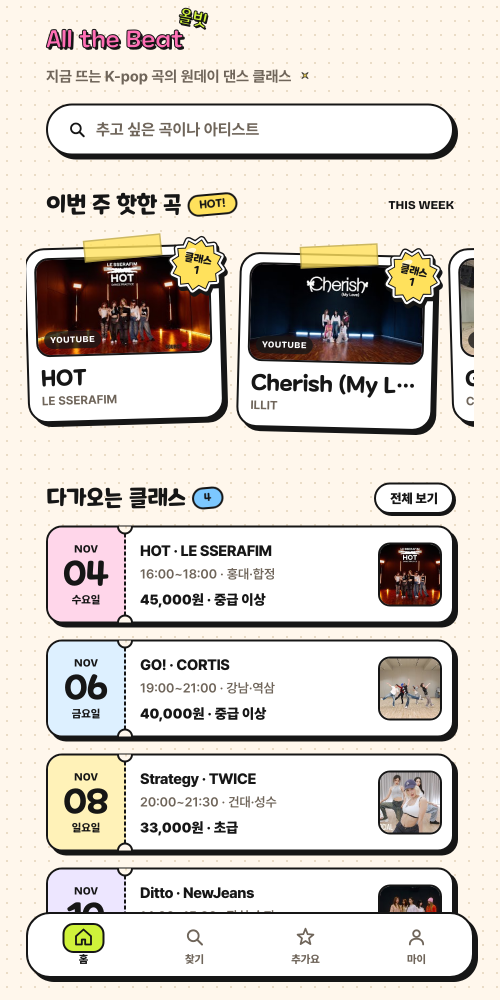
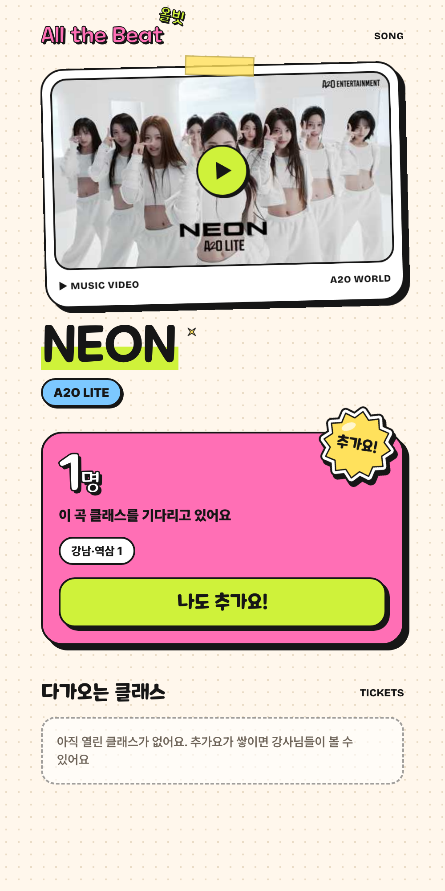
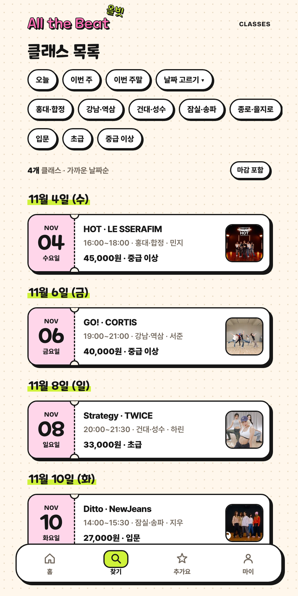
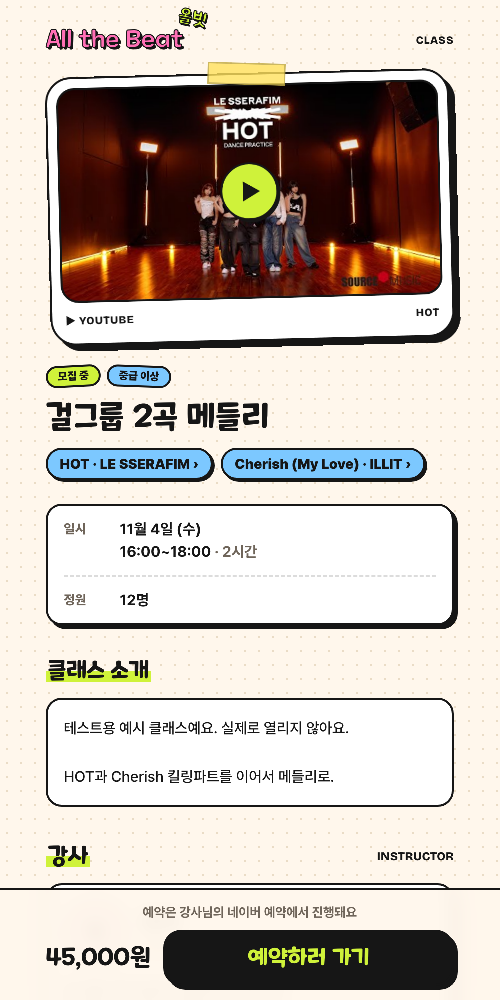

# 올빗 (All the Beat)

K-pop 원데이 댄스 클래스를 곡으로 찾는 모바일 웹 서비스입니다. 원하는 곡의 클래스가 없으면 "추가요!", 마감됐으면 "앵콜!"로 강사에게 열어 달라고 요청할 수 있습니다.

https://all-the-beat.vercel.app

| 홈 | 곡 상세 · 추가요 | 클래스 목록 | 클래스 상세 |
| --- | --- | --- | --- |
|  |  |  |  |

<sup>화면의 클래스·강사는 샘플 데이터입니다.</sup>

| | |
| --- | --- |
| 기간 | 2026.10.26 ~ |
| 형태 | 개인 프로젝트 (기획·디자인·개발·배포) |
| 스택 | Next.js 16, React 19, TypeScript, Tailwind CSS, Supabase (Postgres·Auth·Storage), Drizzle ORM, Vercel |

## 배경

개인 강사의 원데이 클래스는 대부분 인스타그램 스토리로 공지되고 DM으로 접수됩니다. 수강생 입장에서는 이번 주에 어떤 곡의 클래스가 어디서 열리는지 모아 볼 곳이 없고, 배우고 싶은 곡이 있어도 댓글로 부탁하는 것 말고는 방법이 없습니다. 강사도 어떤 곡을 열어야 사람이 모일지 감으로 정합니다.

올빗은 탐색의 기준을 곡으로 두고, 수강생의 요청을 숫자로 모아 강사에게 보여 줍니다. 예약과 결제는 강사가 이미 쓰는 네이버 예약이나 오픈채팅 링크로 보내서, 강사가 일하는 방식은 바꾸지 않습니다.

## 주요 기능

수강생

- 곡·아티스트 검색, 날짜·권역·난이도로 거르는 클래스 목록
- 곡 상세에서 공식 안무 영상과 그 곡의 클래스 보기
- 추가요(클래스 요청)와 권역별로 볼 수 있는 곡 요청 랭킹, 마감된 클래스의 앵콜 요청
- 클래스 찜, 인스타 스토리용 클래스 이미지 만들기
- 카카오 로그인, 마이페이지, 회원 탈퇴

강사

- 강사 신청(인스타그램 DM 인증 코드), 클래스 등록·수정·마감·취소
- 앵콜 요청 검토와 응답, 클래스 티저 영상
- 강사 프로필 페이지, 운영자가 대신 등록해 둔 클래스 가져오기

운영자

- 강사 승인, 클래스 대리 등록, 곡·아티스트 관리, 클래스 숨김
- 방문·요청·예약 링크 클릭 지표

## 구조

```text
app/src/
├── app/      라우트, 화면, 서버 액션 (입력 파싱과 로그인 확인만)
├── server/   비즈니스 로직 (도메인별 폴더, Next.js·React를 import하지 않음)
├── db/       Drizzle 스키마와 마이그레이션
└── lib/      인증, Supabase 클라이언트, 포맷 같은 공용 도구
```

의존 방향은 `app → server → db` 한 방향이고 ESLint로 강제합니다. 브라우저는 DB에 직접 접근하지 않습니다.

## 설계 결정

### 백엔드를 따로 두지 않음

MVP의 서버 일은 폼 저장, 목록 조회, 집계 정도라 별도 API 서버를 두면 같은 일을 두 번 하게 됩니다. Next.js 풀스택과 Supabase로 정하고, 비즈니스 규칙은 `app/src/server/`에 순수 TypeScript로 모았습니다. 서버 액션과 Route Handler는 이 함수를 부르기만 하므로, 나중에 앱이나 결제가 붙으면 이 폴더를 별도 서비스로 옮길 수 있습니다. ([07 기술 스택](docs/07-기술스택.md))

### Drizzle ORM

스키마에 부분 인덱스, CHECK 제약, RLS, `pg_trgm` 검색 인덱스가 들어갑니다. Prisma에서는 이 중 일부를 마이그레이션 SQL에 직접 써야 해서 스키마 정의가 두 곳으로 나뉩니다. Drizzle은 TypeScript 스키마 한 곳에서 관리할 수 있어 골랐습니다.

### 브라우저에 DB 권한을 주지 않음

모든 테이블에 RLS를 켜고 브라우저용 정책은 만들지 않았습니다. 공개 키가 노출되어도 DB를 직접 읽거나 쓸 수 없고, 권한 확인은 `src/server`의 함수에서 합니다. ([08 시스템 아키텍처](docs/08-시스템아키텍처.md))

### 인앱 브라우저 로그인을 먼저 검증

사용자 대부분이 인스타그램 링크로 들어오기 때문에, 인스타그램 인앱 브라우저에서 카카오 로그인 후 원래 화면으로 돌아와 요청 시트가 열리는지를 화면 개발 전에 확인했습니다. 이 과정에서 Supabase가 이메일 동의를 항상 요청해 일반 카카오 앱으로는 로그인이 막히는 문제(KOE205)를 찾아 비즈 앱으로 전환했습니다. ([기술 검증 T-1](docs/spike-01-인앱로그인검증.md))

### 예약·결제는 만들지 않음

"예약하러 가기"는 `/go/{id}`에서 클릭을 기록한 뒤 강사의 예약 링크로 보냅니다. 이 클릭 수를 탐색이 실제 수강 의도로 이어졌는지 보는 지표로 씁니다.

### 디자인

다크·네온, 스티커 키치, 흑백 팬진 세 방향을 HTML 시안으로 비교한 뒤 "덕질 스크랩북" 콘셉트로 정했습니다. 곡은 포토카드, 클래스는 절취선 티켓 모양입니다. ([design/](design/README.md))

## 개발 방식

Claude Code와 함께 개발했습니다. 세션이 바뀌어도 같은 기준으로 작업하도록 제품 원칙, 코딩 규칙, 디자인 규칙을 [`_agent/rules/`](_agent/rules/)에 두고 [`AGENTS.md`](AGENTS.md)에서 읽게 했습니다. 기능마다 [`specs/`](specs/)에 요구사항, 구현 계획, 진행 기록, 구현 중 내린 결정을 남겼습니다.

머지 전에는 `pnpm check`(타입 검사·린트·빌드)를 돌리고 스펙의 성공 기준을 화면에서 직접 확인합니다. 자동화 테스트는 아직 없습니다.

## 저장소

| 폴더 | 내용 |
|---|---|
| [app/](app/) | Next.js 앱 |
| [docs/](docs/) | 리서치, 기획서, 기능 명세, IA, 유저 플로우, 아키텍처, ERD |
| [specs/](specs/) | 기능별 스펙 |
| [design/](design/) | 디자인 시안과 최종 방향 |
| [wireframes/](wireframes/) | HTML 와이어프레임 |
| [_agent/](_agent/) | 개발 규칙과 작업 절차 |

실행 방법은 [docs/DEVELOPMENT.md](docs/DEVELOPMENT.md)에 있습니다.

### 설계 문서

| 문서 | 내용 |
|---|---|
| [00 리서치](docs/00-리서치_유사서비스.md) | 유사 서비스 조사 |
| [01 기획서](docs/01-기획서_One-pager.md) | 문제, 타깃, MVP 범위, 성공 지표 |
| [03 기능 명세서](docs/03-기능명세서.md) | 기능 목록, 화면 목록, 데이터 개요 |
| [04 IA](docs/04-IA.md) | 사이트맵, URL, 권한 |
| [05 유저 플로우](docs/05-유저플로우.md) | 주요 플로우와 상태 다이어그램 |
| [06 음원 API 조사](docs/06-음원API_이미지조사.md) | 곡 정보 API 비교, 이미지 사용 조건 |
| [07 기술 스택](docs/07-기술스택.md) | 스택 선택 근거, 무료 티어 제약 |
| [08 시스템 아키텍처](docs/08-시스템아키텍처.md) | 구성도, 요청 흐름, 보안 |
| [09 ERD](docs/09-ERD.md) | 테이블, 관계, 인덱스, 주요 쿼리 |
| [기술 검증 T-1](docs/spike-01-인앱로그인검증.md) | 인앱 브라우저 카카오 로그인 검증 |
| [서비스명](docs/naming-서비스명_브레인스토밍.md) | 네이밍과 도메인·상표 확인 |
