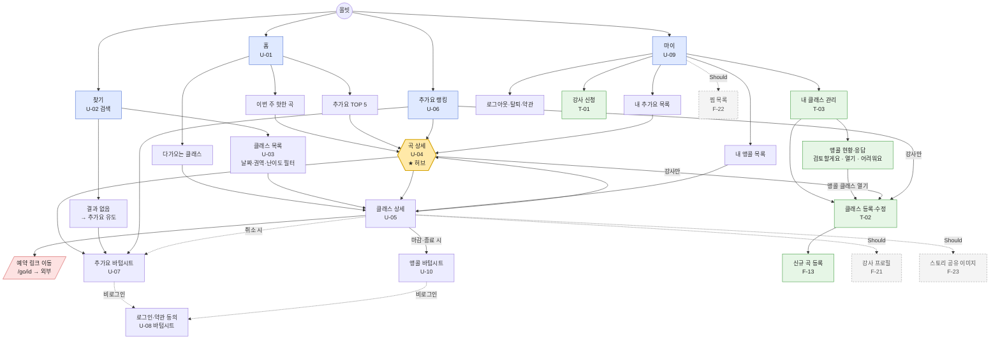
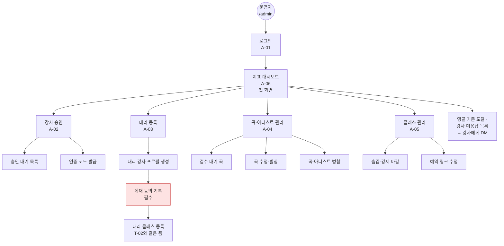

# 04. IA (정보 구조) — 올빗 MVP v0.1

- 작성일: 2026-10-26 (v0.1), 같은 날 v0.2 — 앵콜(F-24) 화면·경로 추가
- 기준 문서: 03-기능명세서 v0.2 (화면 ID U-xx, T-xx, A-xx / 기능 ID F-xx)
- 범위: MVP Must 화면 전체 + Should 화면은 점선으로 표시

---

## 1. 내비게이션 원칙

1. **하단 탭바 4개**: 홈 / 찾기 / 추가요 / 마이. 모바일 웹이라도 앱처럼 엄지로 이동
2. **곡 상세(U-04)가 허브.** 홈·검색·목록·랭킹·클래스 상세 어디서든 곡 이름을 누르면 곡 상세로 간다
3. **강사 메뉴는 탭을 따로 두지 않는다.** 수강생과 같은 화면을 쓰고, 강사에게만 버튼이 더 보인다 ("이 곡으로 클래스 열기", 마이 > 내 클래스)
4. **로그인은 화면이 아니라 바텀시트.** 추가요·강사 신청을 누르는 순간에만 뜨고, 끝나면 원래 자리로 돌아온다
5. **운영자 화면은 완전히 분리** (`/admin`, 별도 로그인, 탭바 없음)

### 하단 탭바

| 탭 | 화면 | 아이콘 의미 | 비고 |
|---|---|---|---|
| 홈 | U-01 | 집 | |
| 찾기 | U-02 → U-03 | 돋보기 | 누르면 검색창에 바로 포커스 |
| 추가요 | U-06 | 손 들기 / 하트+ | 서비스 정체성 탭 |
| 마이 | U-09 | 사람 | 비로그인이면 로그인 유도 화면 |

탭바가 **보이는** 화면: U-01, U-03, U-06, U-09
탭바가 **숨는** 화면: 상세(U-04, U-05), 입력(U-07, T-01, T-02), 검색 입력 중(U-02) — 대신 상단 뒤로가기

---

## 2. 사이트맵 — 수강생·강사 영역

**범례**: 파란색 = 하단 탭 / 노란색 = 허브(곡 상세) / 초록색 = 강사 전용 / 빨간색 = 외부로 나감 / 회색 점선 = Should

---

## 3. 사이트맵 — 운영자 영역

---

## 4. URL 구조

| 화면 | URL | 로그인 | 비고 |
|---|---|---|---|
| U-01 홈 | `/` | - | |
| U-02 검색 | `/search` | - | 검색어 입력 상태 |
| U-03 클래스 목록 | `/classes?q=&date=&region=&level=` | - | 필터를 쿼리로 유지 → 공유 가능 |
| U-04 곡 상세 | `/song/{slug}` | - | 예: `/song/a2o-lite-neon`. **OG 태그·검색 노출 필수** |
| U-05 클래스 상세 | `/class/{id}` | - | OG 태그 필수 |
| 예약 링크 이동 | `/go/{classId}` | - | 클릭 기록 후 외부 리다이렉트. 화면 없음 |
| U-06 추가요 랭킹 | `/requests?region=` | - | |
| U-07 추가요 | (바텀시트, URL 없음) | 필요 | `?request=open` 쿼리로 로그인 복귀 시 자동 오픈 |
| U-08 로그인 | (바텀시트) `/auth/kakao/callback` | - | 콜백 후 `returnTo`로 복귀 |
| U-09 마이 | `/me` | 필요 | |
| T-01 강사 신청 | `/me/teacher/apply` | 필요 | |
| T-02 클래스 등록 | `/me/classes/new` · `/me/classes/{id}/edit` | 강사 | `?song={slug}` 로 곡 미리 선택 |
| T-03 내 클래스 | `/me/classes` | 강사 | |
| A-xx 운영자 | `/admin/*` | 운영자 | 검색 노출 차단 (noindex) |
| F-21 강사 프로필 (Should) | `/teacher/{handle}` | - | |
| 약관 | `/terms`, `/privacy` | - | |

---

## 5. 권한별 접근

| 화면 | 게스트 | 수강생 | 강사 | 운영자 |
|---|---|---|---|---|
| 홈·찾기·목록·곡 상세·클래스 상세·랭킹 | ✅ | ✅ | ✅ | ✅ |
| 추가요 남기기 | 🔑 로그인 유도 | ✅ | ✅ | - |
| 앵콜 남기기 | 🔑 로그인 유도 | ✅ | ✅ | - |
| 내 클래스의 앵콜 현황·응답 | ❌ | ❌ | ✅ (본인 클래스) | ✅ |
| 랭킹의 권역·시간대·한마디 상세 | ❌ | ❌ | ✅ | ✅ |
| 곡 상세의 "이 곡으로 클래스 열기" | ❌ | ❌ | ✅ | ✅ (대리) |
| 마이 | 🔑 | ✅ | ✅ | - |
| 강사 신청 | 🔑 | ✅ | (이미 강사) | - |
| 클래스 등록·관리 | ❌ | ❌ (신청 안내) | ✅ | ✅ (대리) |
| /admin | ❌ | ❌ | ❌ | ✅ |

🔑 = 누르면 로그인 바텀시트

---

## 6. 화면 연결표 (어디서 와서 어디로 가나)

| 화면 | 들어오는 곳 | 나가는 곳 |
|---|---|---|
| U-01 홈 | 탭바, 로고 | U-02, U-03, U-04, U-05, U-06 |
| U-02 검색 | 탭바, 홈 검색창, 목록 상단 | U-03(엔터), U-04(곡 선택), U-07(결과 없음) |
| U-03 클래스 목록 | U-02, 홈 "더보기" | U-05 |
| **U-04 곡 상세** | 홈, 검색, 랭킹, U-05, 마이 추가요 목록, **외부 공유 링크** | U-05, U-07, T-02(강사) |
| U-05 클래스 상세 | 홈, 목록, U-04, 마이 앵콜 목록, **외부 공유 링크** | 외부 예약(`/go`), U-04, U-10 앵콜(마감·종료 시), U-07(취소 시), 지도 앱, 강사 인스타 |
| U-10 앵콜 시트 | U-05 | 직전 화면 (완료 토스트, 진행 바 갱신) |
| U-06 추가요 랭킹 | 탭바, 홈 TOP 5 "더보기" | U-04, U-07, T-02(강사) |
| U-07 추가요 시트 | U-04, U-02, U-05, U-06 | 직전 화면 (완료 토스트) |
| U-09 마이 | 탭바 | U-04, T-01, T-03 |
| T-02 클래스 등록 | T-03, U-04(강사), U-06(강사) | 등록 완료 → U-05 (내가 만든 클래스) |

**외부에서 바로 들어오는 화면**: U-04 곡 상세, U-05 클래스 상세 → 이 두 화면은 탭바 없이 들어와도 **로고·"올빗 둘러보기" 버튼으로 홈 진입로**가 있어야 한다 (인스타 인앱 브라우저 유입 대비)

---

## 7. 깊이 점검

- 홈 → 원하는 곡의 클래스 예약까지: **홈 → 곡 상세 → 클래스 상세 → 예약하기 = 3탭**
- 검색 → 추가요: **찾기 → 검색어 → 결과 없음의 [추가요!] → 시트 완료 = 3탭** (로그인 제외)
- 강사가 요청을 보고 클래스 열기: **추가요 탭 → 곡 행의 [클래스 열기] → 폼 저장 = 2탭 + 입력**

## 8. 열린 질문

| # | 질문 |
|---|---|
| IA-1 | 탭 이름 "추가요"가 랭킹 화면 이름으로 직관적인가? ("요청", "기다리는 곡"과 비교 필요) |
| IA-2 | 찾기 탭과 홈 검색창이 겹친다. 탭을 "클래스"(목록 바로 열기)로 바꾸는 안도 있음 |
| IA-3 | 강사가 많아지면 "강사 모드" 전환이 필요할 수 있음 (MVP는 마이 안에 둠) |
