# 05. 유저 플로우 — 올빗 MVP v0.1

- 작성일: 2026-10-26 (v0.1), 같은 날 v0.2 — 플로우 10 앵콜, S-4 추가, v0.3 — 앵콜 검토 중 취소 처리 규칙
- 기준 문서: 03-기능명세서 v0.2, 04-IA v0.2 (화면 ID U-xx, T-xx, A-xx / 기능 ID F-xx)
- 범례: 둥근 사각형 = 시작·끝 / 사각형 = 화면·행동 / 마름모 = 판단 / 평행사변형 = 외부 이동 / 점선 = 예외·대체 경로

## 플로우 목록

| # | 플로우 | 사용자 | 왜 중요한가 |
|---|---|---|---|
| 1 | 곡으로 클래스 찾아 예약하기 | 수강생 | 서비스의 1차 가치 |
| 2 | 인스타 공유 링크로 들어와 예약하기 | 수강생 | 실제 유입 대부분이 이 경로 |
| 3 | 추가요 남기기 (로그인 포함) | 수강생 | 핵심 무기. 로그인 복귀가 끊기면 안 됨 |
| 4 | 강사 신청 → 인증 → 승인 | 강사·운영자 | 공급 입구 |
| 5 | 추가요를 보고 클래스 열기 | 강사 | 요청 → 개설 전환 (핵심 가설) |
| 6 | 클래스 등록 (신규 곡 포함) | 강사 | "1분 등록" 목표 |
| 7 | 콘시어지 대리 등록 | 운영자 | 초기 공급의 핵심 |
| 8 | 곡 중복 병합 | 운영자 | 곡 중심 서비스의 데이터 품질 |
| 9 | 대리 프로필 가져오기 (클레임) | 강사 | Should |
| 10 | 앵콜: 마감·종료 클래스 재오픈 요청 → 앵콜 클래스 | 수강생·강사·운영자 | 마감을 수요로 바꾼다 (2026-10-26 추가) |
| S | 상태 다이어그램: 클래스 / 추가요 / 강사 / 앵콜 | - | 개발 시 상태 로직 기준 |

---

## 1. 곡으로 클래스 찾아 예약하기 (수강생)

**시나리오**: "NEON 안무 배우고 싶다" → 이번 주말 홍대 클래스를 찾아 네이버 예약으로 간다.

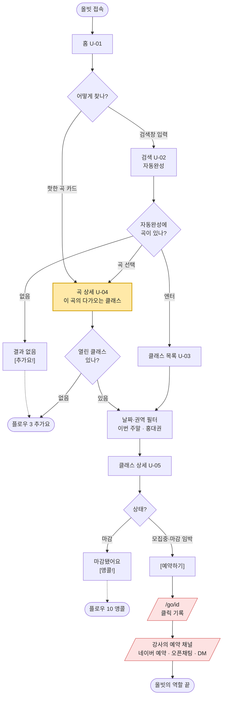

**체크 포인트**
- 올빗의 성공 기준은 "외부 예약 채널로 넘어간 순간"(`/go` 클릭)까지다. 실제 예약 성사 여부는 모른다
- 마감된 클래스는 앵콜(플로우 10)로, 클래스가 없는 곡은 추가요(플로우 3)로 이어져서 **막다른 길이 없다**

---

## 2. 인스타 공유 링크로 들어와 예약하기 (수강생)

**시나리오**: 강사 스토리의 링크 스티커 또는 친구 카톡 공유로 곡/클래스 페이지에 바로 들어온다.

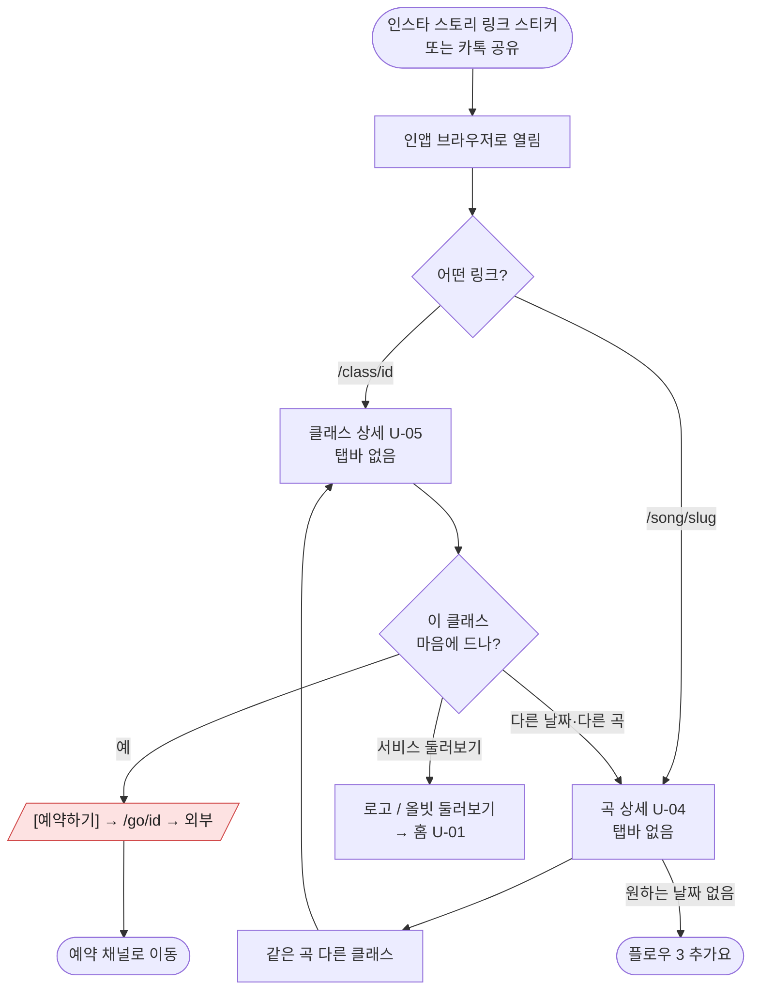

**체크 포인트**
- 인앱 브라우저는 뒤로가기 히스토리가 없다 → 상세 화면 상단에 **홈으로 가는 길** 필수 (IA 6절)
- OG 태그 미리보기가 이 플로우의 첫 화면이나 마찬가지다 (곡명·일시·권역이 미리보기에 보여야 클릭한다)

---

## 3. 추가요 남기기 (수강생)

**시나리오**: 원하는 곡 클래스가 없어서 "열어주세요"를 남긴다. 로그인이 안 된 상태에서 시작한다.

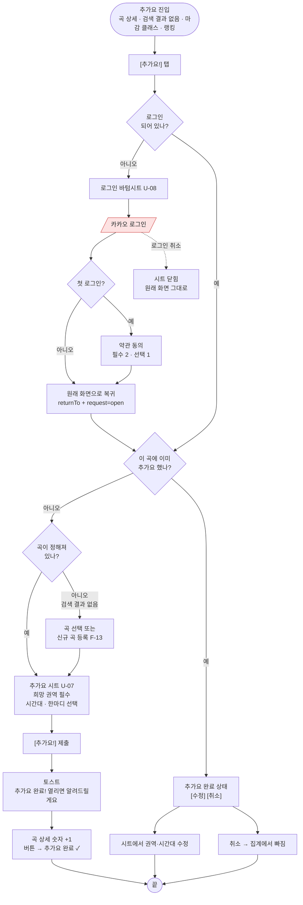

**체크 포인트**
- **로그인 → 복귀 → 시트 자동 오픈**이 끊기면 추가요 전환율이 급락한다. 인앱 브라우저에서 카카오 로그인 리다이렉트가 제대로 돌아오는지 출시 전 필수 테스트
- 사용자 × 곡 = 1건. 두 번째 탭은 새 요청이 아니라 수정/취소

---

## 4. 강사 신청 → 인증 → 승인 (강사·운영자)

**시나리오**: 개인 강사가 올빗에 직접 클래스를 올리려고 강사 신청을 한다.

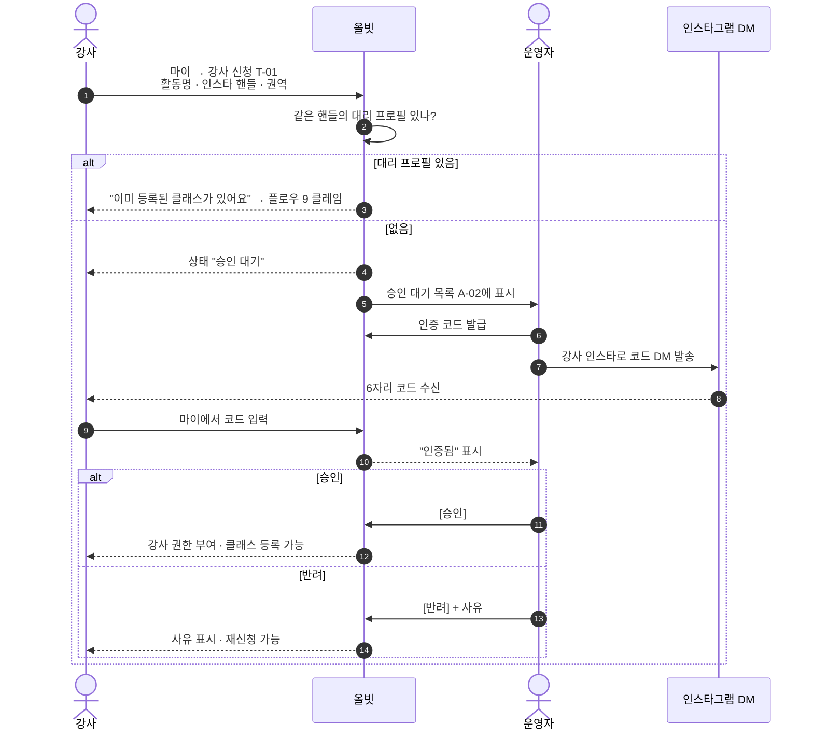

**체크 포인트**
- MVP는 인증 코드 DM을 운영자가 **수동으로** 보낸다. 신청이 하루 10건 넘으면 자동화 검토
- 인증 코드가 틀리거나 만료(24시간)되면 운영자가 재발급

---

## 5. 추가요를 보고 클래스 열기 (강사) ★ 핵심 가설 검증 플로우

**시나리오**: 강사가 "이번에 뭐 열지?" 고민하다 올빗 추가요 랭킹에서 수요를 확인하고 클래스를 연다.

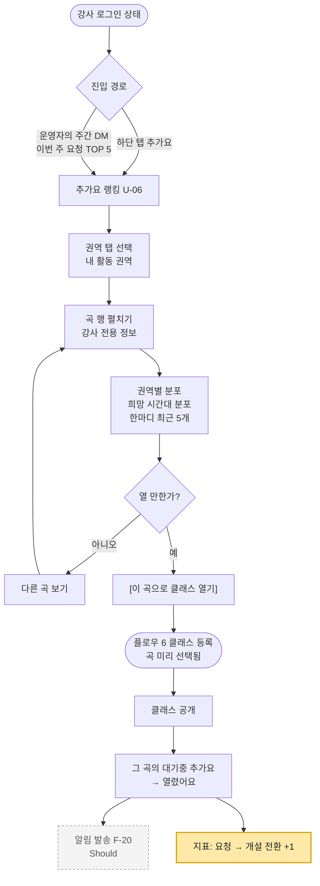

**체크 포인트**
- 초기엔 강사가 스스로 랭킹을 보러 오지 않는다 → **운영자가 주 1회 "이번 주 요청 TOP 5"를 강사에게 DM**으로 보내는 수동 운영이 이 플로우의 실제 시작점 (기획서 리스크 대응)
- 이 플로우가 한 번이라도 완주되면 성공 지표 "요청 → 개설 전환 1곡" 달성

---

## 6. 클래스 등록 (강사)

**시나리오**: 다음 주 토요일 NEON 클래스를 등록한다. 목표 1분.

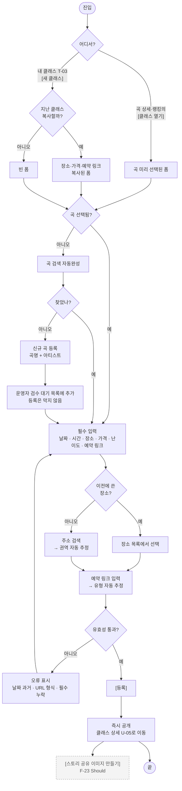

**체크 포인트**
- 반복 등록하는 강사는 "복사" 경로로 **날짜·곡만 바꾸면 끝**나야 한다
- 신규 곡 등록이 흐름을 끊지 않는다 (검수는 나중에 운영자가)

---

## 7. 콘시어지 대리 등록 (운영자) ★ 초기 공급

**시나리오**: 운영자가 인스타에서 원데이 클래스 공지를 발견하고 올빗에 옮겨 담는다.

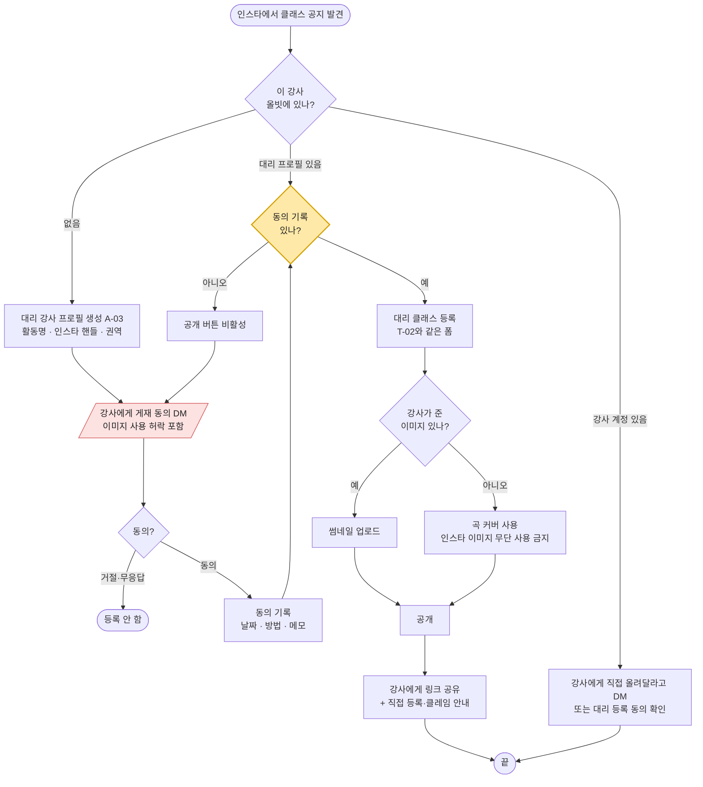

**체크 포인트**
- **동의 기록 없이는 공개 불가** — 시스템이 막는다
- 등록 후 강사에게 링크를 보내는 것 자체가 강사 유입 마케팅이다 ("올빗에 선생님 클래스 올려뒀어요, 직접 관리하시려면…")

---

## 8. 곡 중복 병합 (운영자)

**시나리오**: 강사 A는 "NEON", 수강생 B는 "네온"으로 곡을 따로 만들었다.

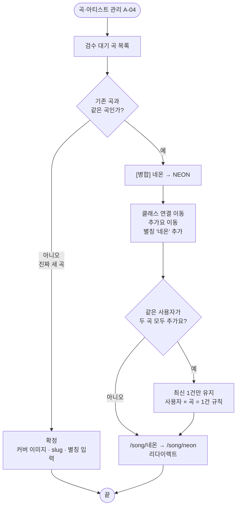

**체크 포인트**
- 병합 시 **추가요 중복 제거**를 빼먹으면 랭킹 숫자가 부풀려진다
- 병합된 곡 URL은 공유된 적이 있을 수 있으므로 반드시 리다이렉트

---

## 9. 대리 프로필 가져오기 — 클레임 (강사, Should)

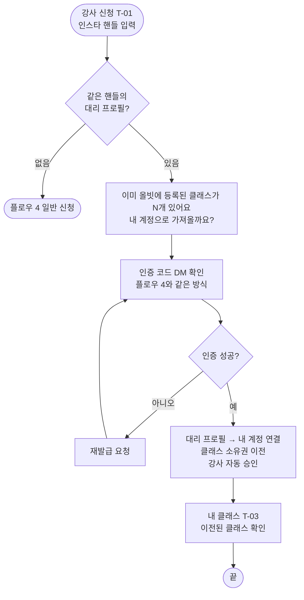

---

## 10. 앵콜: 마감·종료 클래스 재오픈 요청 → 앵콜 클래스 (수강생·강사·운영자)

**시나리오**: 인기 강사의 NEON 클래스가 하루 만에 마감됐다. 못 들어간 사람들이 [앵콜!]을 누르고, 기준 인원이 모이자 강사에게 전달되어 다음 주에 앵콜 클래스가 열린다.

### 10-1. 수강생: 앵콜 남기기

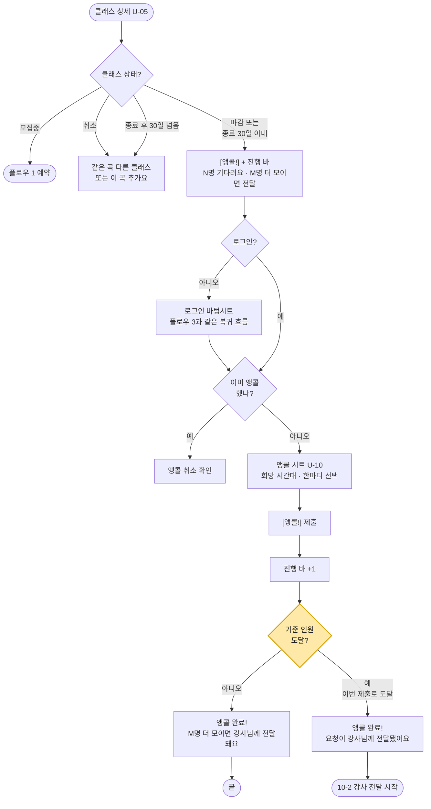

### 10-2. 강사 전달 → 응답 → 앵콜 클래스

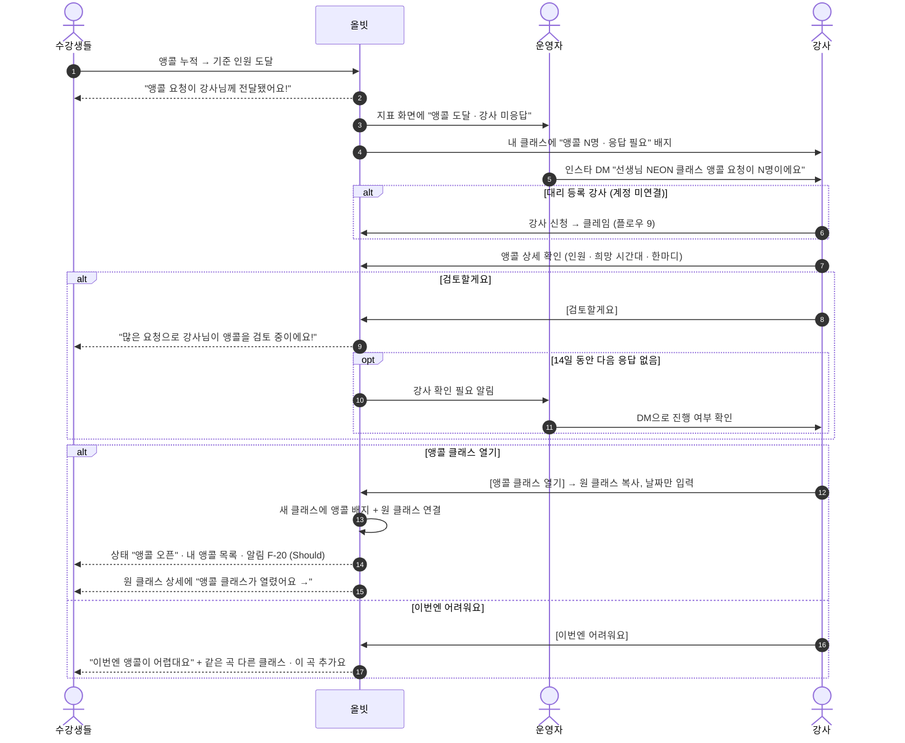

**체크 포인트**
- **"검토 중" 문구는 강사가 [검토할게요]를 눌렀을 때만** 보여준다. 기준만 넘었을 때는 "전달됐어요"까지만 말한다 (사실과 다른 문구 금지)
- 앵콜은 강사 유입의 좋은 계기다. 대리 등록 강사에게 "앵콜 요청 N명"은 올빗에 직접 가입할 가장 강한 이유가 된다
- 앵콜 클래스는 "복사해서 만들기"로 열리므로 강사는 **날짜만 고르면 끝**이다
- **검토 중 취소** (2026-10-26 결정): 취소는 막지 않는다. 확인 창 "취소하면 강사님이 보는 앵콜 인원에서 빠져요" 후 취소. 상태는 "검토 중" 유지, 강사에게는 "검토 시작 시점 N명 · 지금 M명"으로 보인다
- 강사 앵콜 상세에는 "앵콜은 예약이 아니라 관심 표시예요" 안내를 고정으로 보여 기대치를 맞춘다
- **우선 예약은 MVP에서 하지 않는다.** 외부 예약 채널은 강사가 직접 관리해서 시스템이 "먼저"를 보장할 수 없다 (MVP 원칙 6)

---

## S. 상태 다이어그램

### S-1. 클래스 상태

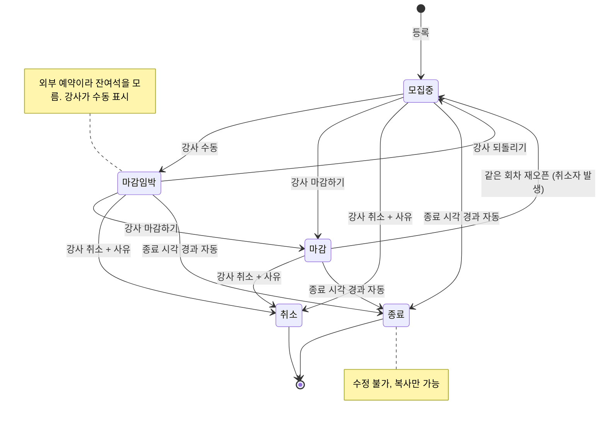

운영자는 모든 상태에서 **숨김**(목록·검색에서 제외) 처리 가능. 숨김은 상태와 별개 플래그.

### S-2. 추가요 상태

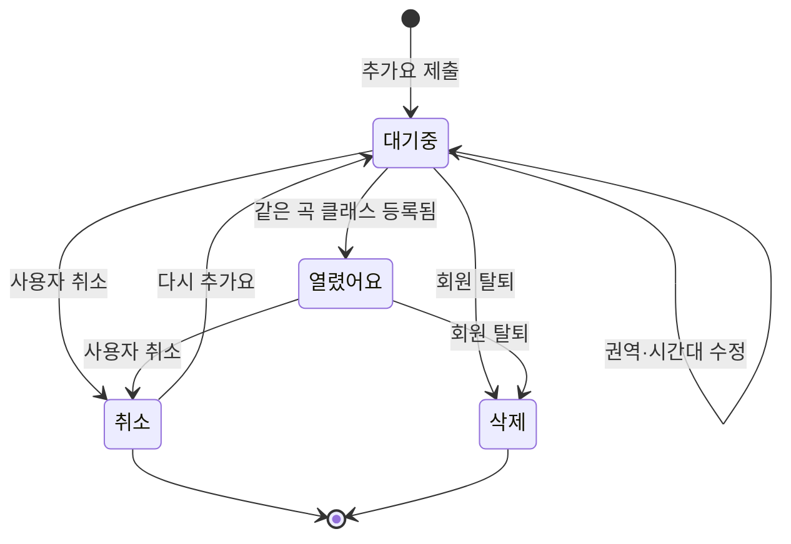

- "열렸어요"가 된 추가요도 랭킹 집계에서는 기간(30일) 안이면 계속 센다 [가정: 열린 뒤에도 수요가 있다는 신호]

### S-3. 강사 프로필 상태

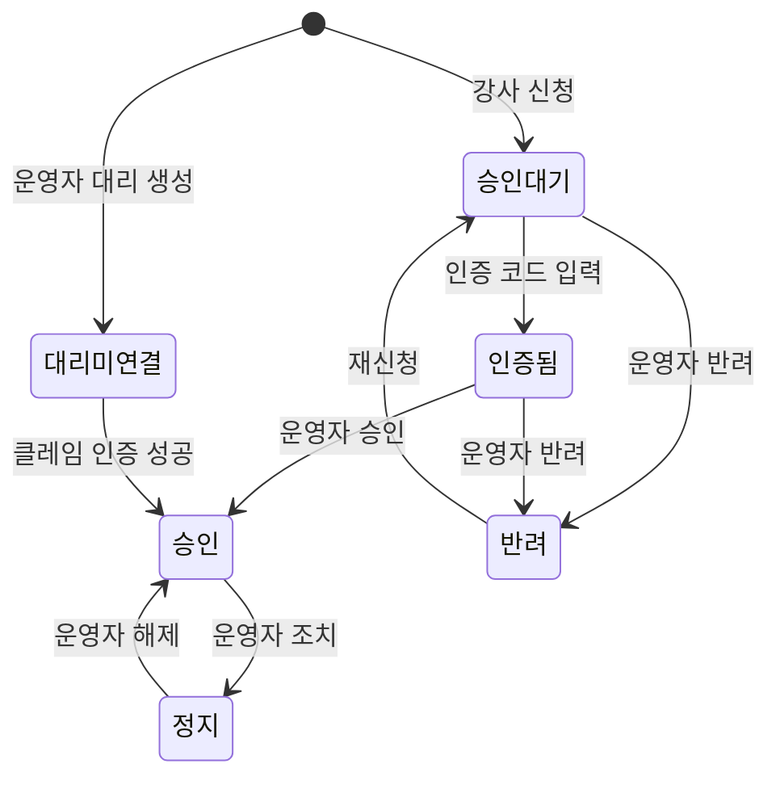

### S-4. 앵콜 상태 (클래스 1개 기준)

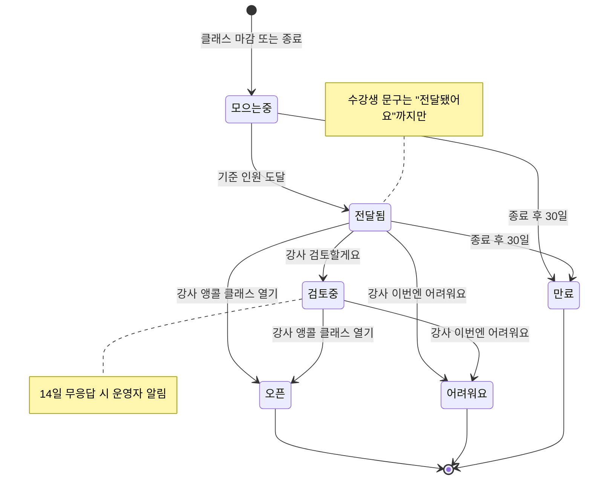

- 앵콜 클래스가 다시 마감되면 그 클래스에서 **새 앵콜 라운드**가 시작된다 (원 클래스와 별개)
- **상태는 뒤로 가지 않는다**: 전달됨·검토중에서 취소로 인원이 기준 아래로 내려가도 모으는중으로 돌아가지 않는다. 그래서 다이어그램에 역방향 화살표가 없다
- 검토중으로 바뀌는 순간의 인원을 `count_at_review`로 저장해 강사 화면의 기준점으로 쓴다

---

## 열린 질문

| # | 질문 | 관련 플로우 |
|---|---|---|
| UF-1 | 인스타 인앱 브라우저에서 카카오 로그인 리다이렉트가 정상 복귀하나? (기술 검증 필요) | 3 |
| ~~UF-2~~ | ~~마감된 클래스를 "재오픈"할 일이 실제로 있나?~~ → **해결 (2026-10-26)**: 같은 회차 재오픈(취소자 발생)은 S-1의 마감→모집중, 새 날짜로 다시 여는 건 **앵콜**(플로우 10, F-24) | S-1, 10 |
| UF-5 | 앵콜 기준 인원(정원 30%, 최소 3명)이 강사가 움직일 만한 숫자인가? | 10 |
| UF-6 | 강사 인터뷰: 앵콜 인원 대비 실제 예약이 어느 정도면 "열 만하다"고 느끼나? | 10 |
| UF-3 | 강사가 마감을 안 누를 때 운영자가 대신 마감 처리할 기준은? (예: 강사 인스타에 "마감" 공지 확인 시) | S-1, 7 |
| UF-4 | 대리 등록 클래스의 예약 링크가 "인스타 DM"뿐이면 `/go`가 인스타 프로필로 가는 게 맞나? | 1, 7 |
