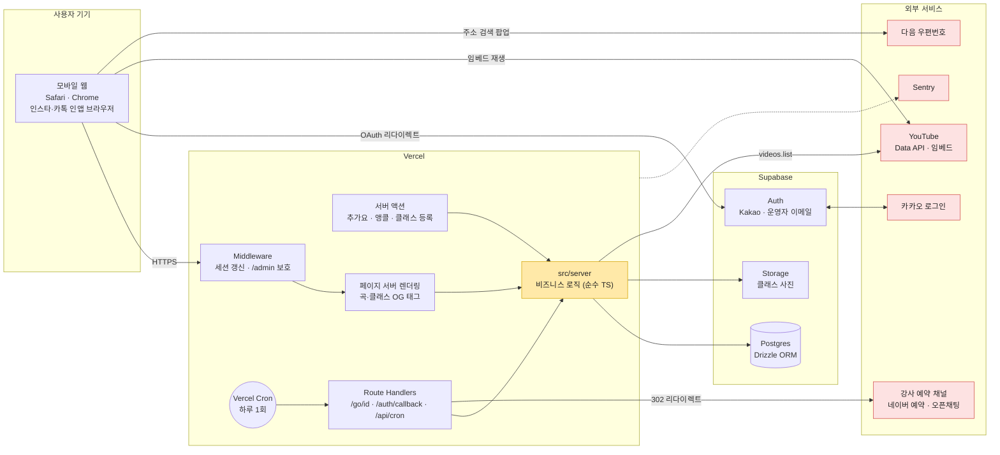
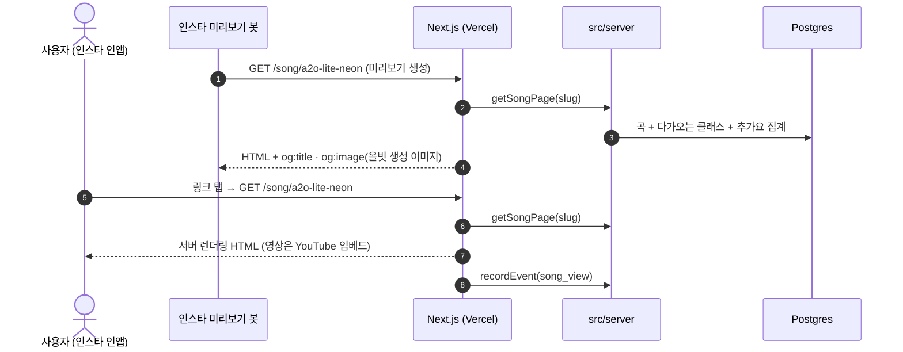
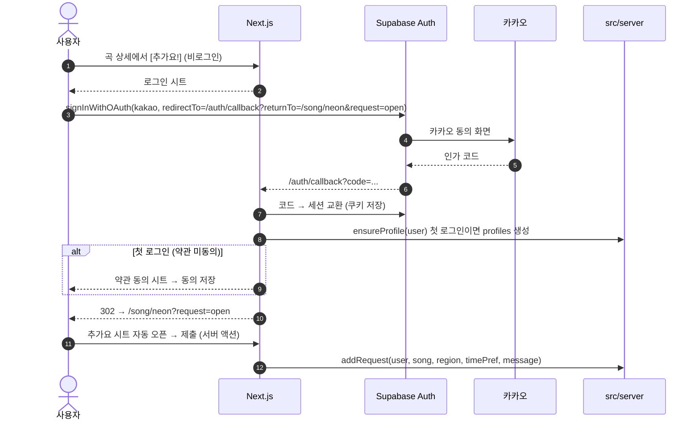
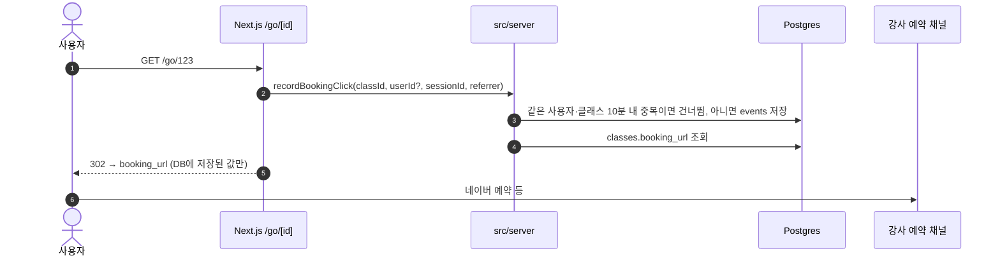
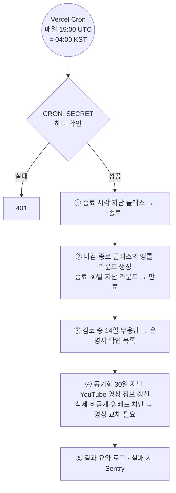
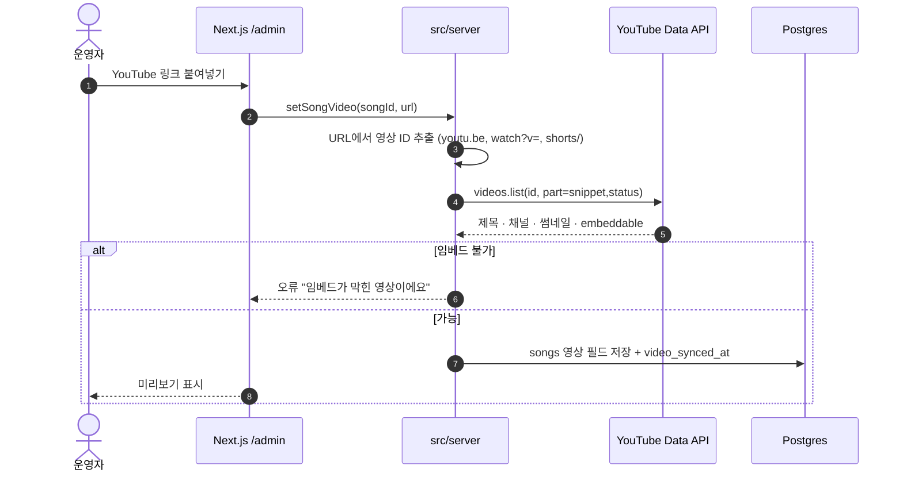

# 08. 시스템 아키텍처 — 올빗 MVP

- 작성일: 2026-10-27
- 기준: 07-기술스택 (확정), 03-기능명세서 v0.5, 05-유저플로우 v0.3
- 다음: 09-ERD

---

## 1. 전체 구성

| 구성 요소 | 역할 |
|---|---|
| **Middleware** | Supabase 세션 쿠키 갱신, `/me/*`·`/admin/*` 접근 시 로그인·권한 확인 |
| **페이지 서버 렌더링** | 곡·클래스·홈·목록 화면. 곡·클래스는 OG 메타데이터를 서버에서 생성 |
| **서버 액션** | 폼 제출 (추가요, 앵콜, 클래스 등록·상태 변경, 강사 신청, 운영자 작업) |
| **Route Handlers** | `/go/{id}` 클릭 기록 후 리다이렉트, `/auth/callback` 로그인 복귀, `/api/cron/daily` 배치 |
| **src/server** | 모든 비즈니스 규칙 (상태 전이, 집계, 권한 검사). Next.js에 의존하지 않음 (07 문서 6절) |
| **Supabase Auth** | 카카오 로그인(이메일 없이), 운영자 이메일 로그인. 사용자 정보 본체는 우리 `profiles` 테이블 |
| **Postgres** | 모든 데이터. 서버만 접근 (3절) |
| **Storage** | 클래스 썸네일. 서버가 발급한 서명 URL로만 업로드 |

---

## 2. 핵심 요청 흐름

### 2.1 인스타 공유 링크로 곡 페이지 진입 (서버 렌더링 + OG)

- 병합된 곡의 옛 slug → 새 slug로 **301 리다이렉트** (F-16)
- OG 이미지는 Next.js 이미지 생성(`opengraph-image`)으로 곡명·아티스트·올빗 로고를 그린다 (YouTube 썸네일 사용 안 함, 03 명세 F-04)

### 2.2 로그인 → 원래 화면 복귀 → 추가요 (플로우 3)

- **기술 검증 1순위 (T-1)**: 인스타·카톡 인앱 브라우저에서 이 흐름이 끊기지 않는지 개발 첫 주에 실제 기기로 확인
- `returnTo`는 **우리 도메인의 상대 경로만** 허용 (오픈 리다이렉트 방지)

### 2.3 예약하기 클릭 (F-06)

- 리다이렉트 대상은 **DB에 저장된 그 클래스의 링크뿐**. 쿼리 파라미터로 받은 URL로 보내지 않는다 (오픈 리다이렉트 방지)

### 2.4 하루 1회 배치 (매일 04:00 KST)

- 각 작업은 **여러 번 실행돼도 결과가 같게**(멱등) 만든다. 크론이 중복 실행되거나 실패 후 재실행돼도 안전하게
- Vercel Hobby 크론은 ±59분 오차 → 정확한 시각이 필요한 일은 배치에 맡기지 않는다
- 클래스 상태 "종료"는 배치 전에도 화면에서 **종료 시각으로 즉석 판단**해서 보여준다 (배치는 DB 정리용)

### 2.5 대표 영상 등록 (운영자, F-16)

---

## 3. 데이터 접근·보안 원칙

| 원칙 | 내용 |
|---|---|
| **DB는 서버만** | 브라우저는 Supabase DB에 직접 쿼리하지 않는다. 모든 읽기·쓰기는 Next.js 서버 → `src/server` → Drizzle |
| **RLS는 기본 거부** | 모든 테이블에 RLS를 켜고 anon·authenticated 역할 정책을 두지 않는다 → 혹시 공개 키가 새도 직접 접근 불가 |
| **권한은 코드에서** | `src/server`의 각 함수가 "누가 이걸 해도 되나"를 먼저 검사 (본인 추가요만 수정, 강사는 자기 클래스만, 운영자만 /admin) |
| **파일 업로드** | 서버가 강사 권한 확인 후 Storage **서명 업로드 URL** 발급 → 브라우저가 그 URL로만 업로드 |
| **비밀 값** | YouTube API 키, Supabase 서비스 키, DB 접속 정보, CRON_SECRET은 Vercel 환경변수 (서버 전용) |
| **리다이렉트** | `/go`는 DB의 링크로만, 로그인 `returnTo`는 상대 경로만 |
| **입력 검증** | 모든 서버 액션 입력을 zod로 검증 (클라이언트 검증과 같은 스키마) |
| **개인정보 최소화** | 카카오 ID·닉네임만. 이벤트 로그의 IP는 저장하지 않고 세션 ID(쿠키)만 |

---

## 4. 렌더링·캐시 전략 (MVP)

| 화면 | 방식 | 이유 |
|---|---|---|
| 곡 상세, 클래스 상세 | 서버 렌더링 (요청마다) | OG 필수, 추가요 숫자·상태가 자주 바뀜 |
| 홈, 클래스 목록, 랭킹 | 서버 렌더링 (요청마다) | MVP 트래픽에서 충분. 느려지면 60초 캐시 |
| 로그인 사용자 전용 부분 (추가요 완료 여부, 강사 버튼) | 서버 렌더링 시 세션으로 분기 | |
| 운영자 화면 | 서버 렌더링, 검색 노출 차단 | |

> 처음엔 캐시 없이 단순하게. 측정해서 느린 화면만 캐시를 붙인다.

---

## 5. 환경

| 환경 | Next.js | Supabase | 용도 |
|---|---|---|---|
| 로컬 | `next dev` | **dev 프로젝트** | 개발 |
| 미리보기 | Vercel Preview (브랜치별) | dev 프로젝트 | PR 확인, 인앱 브라우저 테스트 |
| 운영 | Vercel Production (`main`) | **prod 프로젝트** | 실서비스 |

- Supabase 무료는 프로젝트 2개 → dev 1개 + prod 1개로 딱 맞음
- 카카오 앱도 개발용·운영용 리다이렉트 URL을 각각 등록

**환경변수 (서버 전용 표시 ★)**

| 이름 | 용도 |
|---|---|
| `NEXT_PUBLIC_SUPABASE_URL`, `NEXT_PUBLIC_SUPABASE_PUBLISHABLE_KEY` | 브라우저에서 로그인 시작용 (DB 직접 접근은 RLS로 막힘). 예전 이름은 ANON_KEY |
| `SUPABASE_SECRET_KEY` ★ | Storage 서명 URL 발급 (`sb_secret_...`, 예전 이름 service_role) |
| `DATABASE_URL` ★ | 앱의 Drizzle 접속. Supabase **트랜잭션 풀러(6543)**, `prepare: false` |
| `MIGRATION_DATABASE_URL` ★ | drizzle-kit 마이그레이션. **세션 풀러(5432)**. 로컬에만 두고 Vercel에는 넣지 않음 |
| `YOUTUBE_API_KEY` ★ | videos.list |
| `CRON_SECRET` ★ | 배치 호출 검증 |
| `SENTRY_DSN` | 에러 수집 |

---

## 6. 관측·운영

| 항목 | 방법 |
|---|---|
| 에러 | Sentry (서버·클라이언트) |
| 지표 | `events` 테이블 → 운영자 지표 화면(F-18)에서 바로 집계 |
| 배치 결과 | 실행 요약을 로그 + 실패 시 Sentry 알림 |
| 백업 | Supabase 무료는 자동 백업이 제한적 → 출시 후 주 1회 `pg_dump`를 수동(나중에 스크립트)으로 [가정: 출시 전 재확인] |

## 7. 열린 질문

| # | 질문 |
|---|---|
| AR-1 | 인앱 브라우저 카카오 로그인 복귀가 안 되면? → 대안: "외부 브라우저로 열기" 안내, 또는 로그인 없이 추가요(기기 단위) 허용 검토 |
| AR-2 | 세션 ID 쿠키(비로그인 클릭 중복 제거용)에 대한 개인정보처리방침 문구 |
| AR-3 | Supabase 무료 백업 범위 확인 후 백업 방식 확정 |
