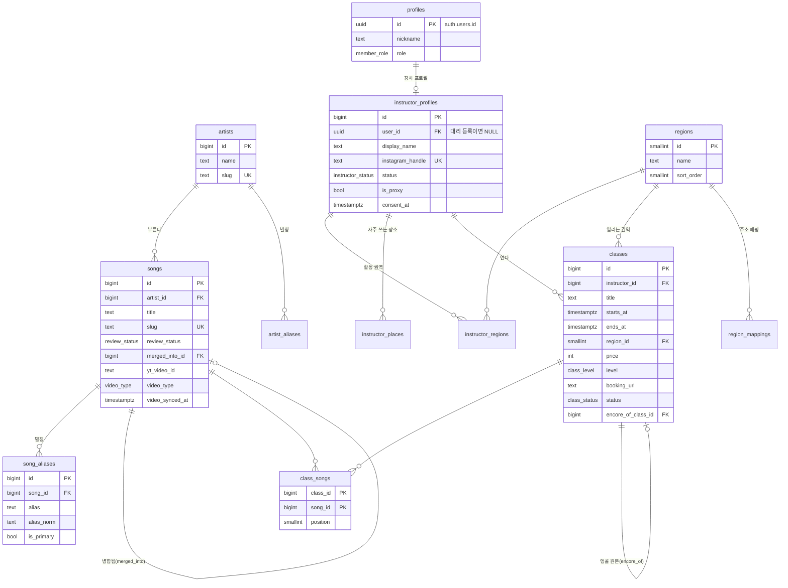
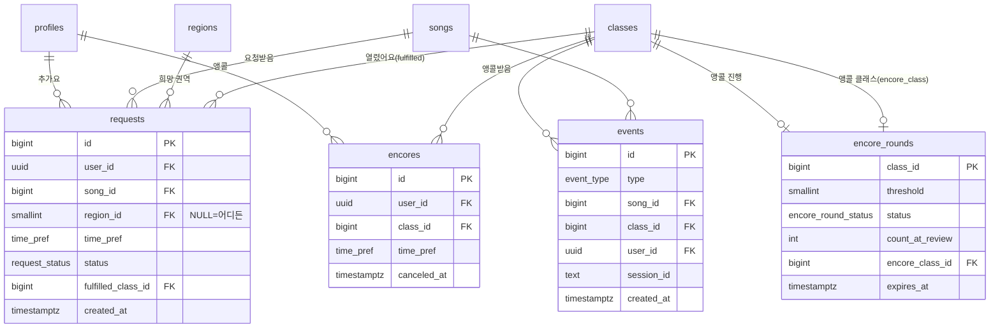

# 09. ERD (데이터 설계) — 올빗 MVP

- 작성일: 2026-10-27
- 기준: 03-기능명세서 v0.5 7절 데이터 개요, 05-유저플로우 상태 다이어그램, 08-시스템아키텍처
- DB: Supabase Postgres, ORM: Drizzle. 시간은 전부 `timestamptz`(UTC 저장, 화면은 KST)

---

## 1. 전체 관계도

### 1.1 곡·클래스·강사 (콘텐츠)



### 1.2 사용자 행동 (추가요·앵콜·이벤트)



---

## 2. 열거형 (Postgres enum)

| enum | 값 | 출처 |
|---|---|---|
| `member_role` | `member`, `admin` | 운영자 구분 |
| `instructor_status` | `pending`, `verified`, `approved`, `rejected`, `suspended` | S-3 (대리 미연결은 `is_proxy=true` + `user_id NULL`) |
| `review_status` | `pending`, `confirmed` | 신규 곡 검수 (F-13, F-16) |
| `video_type` | `dance_practice`, `performance`, `mv` | 대표 영상 유형 (06) |
| `class_level` | `intro`, `beginner`, `intermediate_plus` | 입문 / 초급 / 중급 이상 |
| `booking_type` | `naver`, `kakao_openchat`, `insta_dm`, `google_form`, `other` | 예약 링크 유형 (F-06) |
| `class_status` | `open`, `closing_soon`, `closed`, `ended`, `canceled` | S-1 |
| `time_pref` | `weekday_evening`, `weekend_day`, `weekend_evening`, `any` | 추가요·앵콜 희망 시간대 |
| `request_status` | `waiting`, `opened`, `canceled` | S-2 |
| `encore_round_status` | `collecting`, `delivered`, `reviewing`, `opened`, `declined`, `expired` | S-4 |
| `event_type` | `song_view`, `class_view`, `booking_click`, `search` | 지표 (F-18) |

---

## 3. 테이블 정의

> 표기: **PK** 기본키, **FK** 외래키, **UK** 유일, `NN` NOT NULL. 모든 테이블에 `created_at timestamptz NN default now()`가 있고 표에서는 생략.

### 3.1 사용자

**profiles** — 우리 서비스의 사용자 (Supabase Auth 사용자와 1:1)
| 컬럼 | 타입 | 제약 | 설명 |
|---|---|---|---|
| id | uuid | PK, FK → auth.users.id | |
| nickname | text | NN | 카카오 닉네임 |
| avatar_url | text | | 카카오 프로필 이미지 (선택 동의) |
| role | member_role | NN default `member` | 운영자는 `admin` |
| terms_agreed_at | timestamptz | | 이용약관 동의 시각. NULL이면 동의 시트 표시 |
| privacy_agreed_at | timestamptz | | 개인정보 동의 |
| marketing_agreed_at | timestamptz | | 선택 동의 |
| deleted_at | timestamptz | | 탈퇴 시각 (F-09) |

**instructor_profiles** — 강사 (직접 신청 또는 운영자 대리 생성)
| 컬럼 | 타입 | 제약 | 설명 |
|---|---|---|---|
| id | bigint | PK identity | |
| user_id | uuid | FK → profiles, UK, NULL 허용 | 대리 등록(미연결)이면 NULL. 클레임 시 채움 (F-19) |
| display_name | text | NN | 활동명 |
| instagram_handle | text | NN, UK | **소문자로 저장**, @ 제외 |
| bio | text | | 한 줄 소개 50자 |
| status | instructor_status | NN default `pending` | |
| is_proxy | boolean | NN default false | 운영자 대리 생성 여부 |
| consent_at | timestamptz | | 대리 등록 게재 동의 시각. **NULL이면 그 강사 클래스 공개 불가** (F-15) |
| consent_note | text | | 동의 방법 메모 (DM 캡처 등) |
| verify_code_hash | text | | 인증 코드 해시 (원문 저장 안 함) |
| verify_code_expires_at | timestamptz | | 24시간 |
| approved_at, rejected_reason | timestamptz, text | | |

**instructor_regions** — 강사 주 활동 권역 (다대다)
| 컬럼 | 타입 | 제약 |
|---|---|---|
| instructor_id | bigint | PK, FK |
| region_id | smallint | PK, FK |

### 3.2 권역

**regions** — 권역 목록 (IA·명세 2.1의 8개, 시드 데이터)
| 컬럼 | 타입 | 제약 | 설명 |
|---|---|---|---|
| id | smallint | PK | |
| name | text | NN, UK | "홍대·합정·신촌" |
| short_name | text | NN | 칩용 짧은 이름 "홍대·합정" |
| sort_order | smallint | NN | |

**region_mappings** — 주소 → 권역 자동 매핑 (다음 우편번호 결과 사용)
| 컬럼 | 타입 | 제약 | 설명 |
|---|---|---|---|
| id | int | PK | |
| sigungu | text | NN | "마포구" |
| bname | text | | 법정동 "서교동". NULL이면 구 전체 |
| region_id | smallint | FK NN | |

> 매핑 규칙: (시군구 + 동)이 맞으면 그 권역, 없으면 (시군구 전체), 없으면 "기타 서울". 강사가 바꿀 수 있다.

### 3.3 곡

**artists**
| 컬럼 | 타입 | 제약 | 설명 |
|---|---|---|---|
| id | bigint | PK identity | |
| name | text | NN | 대표 표기 "A2O LITE" |
| slug | text | NN, UK | `a2o-lite` |
| merged_into_id | bigint | FK → artists | 병합 시 |

**artist_aliases** — 아티스트 검색어 (대표 이름도 여기 1행)
| 컬럼 | 타입 | 제약 | 설명 |
|---|---|---|---|
| id | bigint | PK | |
| artist_id | bigint | FK NN | |
| alias | text | NN | "에이투오 라이트" |
| alias_norm | text | NN | 정규화 (5절). UK(artist_id, alias_norm) |
| is_primary | boolean | NN default false | |

**songs**
| 컬럼 | 타입 | 제약 | 설명 |
|---|---|---|---|
| id | bigint | PK identity | |
| artist_id | bigint | FK NN | |
| title | text | NN | "NEON" |
| slug | text | NN, UK | `a2o-lite-neon` |
| release_date | date | | |
| review_status | review_status | NN default `pending` | 운영자 검수 |
| merged_into_id | bigint | FK → songs | 병합되면 대상 곡. 옛 slug 리다이렉트용으로 행은 남김 |
| created_by | uuid | FK → profiles | 누가 처음 등록했나 |
| yt_video_id | text | | 대표 영상 (06) |
| video_type | video_type | | |
| video_title, video_channel, video_thumb_url | text | | YouTube API 값 |
| video_embeddable | boolean | | false면 화면에서 숨김 |
| video_synced_at | timestamptz | | 30일 지나면 배치가 갱신 |

**song_aliases** — 곡 검색어 (제목도 여기 1행)
| 컬럼 | 타입 | 제약 | 설명 |
|---|---|---|---|
| id | bigint | PK | |
| song_id | bigint | FK NN | |
| alias | text | NN | "네온" |
| alias_norm | text | NN | UK(song_id, alias_norm) |
| is_primary | boolean | NN default false | |

### 3.4 클래스

**instructor_places** — "이전 장소" 재사용 (T-02)
| 컬럼 | 타입 | 제약 | 설명 |
|---|---|---|---|
| id | bigint | PK | |
| instructor_id | bigint | FK NN | |
| studio_name | text | NN | |
| address | text | NN | |
| sigungu, bname | text | | 권역 매핑용 |
| region_id | smallint | FK NN | |
| last_used_at | timestamptz | | 최근 쓴 순 정렬 |

**classes**
| 컬럼 | 타입 | 제약 | 설명 |
|---|---|---|---|
| id | bigint | PK identity | URL `/class/{id}`, `/go/{id}` |
| instructor_id | bigint | FK NN | |
| title | text | NN | 비우면 서버가 "{곡명} 원데이 클래스"로 채움 |
| starts_at, ends_at | timestamptz | NN, CHECK ends_at > starts_at | |
| studio_name, address | text | NN | **장소 스냅샷** (장소가 바뀌어도 지난 클래스 기록 유지) |
| place_id | bigint | FK → instructor_places | 어떤 저장 장소에서 왔나 |
| region_id | smallint | FK NN | |
| price | int | NN, CHECK ≥ 0 | 0 = 무료 |
| level | class_level | NN | |
| capacity | smallint | | |
| booking_url | text | NN, CHECK http(s) | |
| booking_type | booking_type | NN | |
| thumbnail_path | text | | Storage 경로 |
| description | text | | 1,000자 |
| teaser_video_id | text | | F-25 (Should) |
| status | class_status | NN default `open` | |
| cancel_reason | text | | |
| is_hidden | boolean | NN default false | 운영자 숨김 (상태와 별개) |
| created_by_admin | boolean | NN default false | 대리 등록 여부 |
| from_request | boolean | NN default false | 추가요 랭킹·곡 상세에서 열었나 (요청→개설 지표) |
| encore_of_class_id | bigint | FK → classes | 앵콜 클래스면 원 클래스 |
| schedule_changed_at | timestamptz | | 일시·장소 수정 시각 → "변경됨" 배지 24시간 |
| updated_at | timestamptz | NN | |

**class_songs** — 클래스에서 배우는 곡 (1~3개)
| 컬럼 | 타입 | 제약 |
|---|---|---|
| class_id | bigint | PK, FK |
| song_id | bigint | PK, FK |
| position | smallint | NN (1~3) |

### 3.5 추가요·앵콜

**requests** — 추가요 (F-07)
| 컬럼 | 타입 | 제약 | 설명 |
|---|---|---|---|
| id | bigint | PK | |
| user_id | uuid | FK NN | |
| song_id | bigint | FK NN | |
| region_id | smallint | FK, NULL 허용 | NULL = 어디든 좋아요 |
| time_pref | time_pref | NN default `any` | |
| message | text | | 100자, 강사·운영자만 열람 |
| status | request_status | NN default `waiting` | |
| fulfilled_class_id | bigint | FK → classes | "열렸어요"가 된 클래스 |
| canceled_at | timestamptz | | |
| updated_at | timestamptz | NN | |
| | | **UK(user_id, song_id)** | 사용자 × 곡 = 1건. 취소 후 다시 하면 같은 행을 `waiting`으로 |

**encores** — 앵콜 (F-24)
| 컬럼 | 타입 | 제약 | 설명 |
|---|---|---|---|
| id | bigint | PK | |
| user_id | uuid | FK NN | |
| class_id | bigint | FK NN | |
| time_pref | time_pref | NN default `any` | |
| message | text | | |
| canceled_at | timestamptz | | NULL이면 유효 |
| | | **UK(user_id, class_id)** | 다시 앵콜하면 canceled_at을 NULL로 |

**encore_rounds** — 클래스별 앵콜 진행 상태 (S-4)
| 컬럼 | 타입 | 제약 | 설명 |
|---|---|---|---|
| class_id | bigint | PK, FK | 클래스당 1개 |
| threshold | smallint | NN | 정원 30% (최소 3), 정원 없으면 5 — 생성 시 계산해 고정 |
| status | encore_round_status | NN default `collecting` | **상태는 뒤로 가지 않는다** (서버에서 전이 검사) |
| reached_at | timestamptz | | 기준 도달 → `delivered` |
| reviewing_at | timestamptz | | |
| count_at_review | int | | 검토 시작 시점 인원 (강사 화면 기준점) |
| responded_at | timestamptz | | 열기·어려워요 응답 |
| encore_class_id | bigint | FK → classes | 열린 앵콜 클래스 |
| expires_at | timestamptz | NN | 원 클래스 종료 + 30일 |

> 현재 앵콜 인원은 저장하지 않고 `encores`에서 센다 (`canceled_at IS NULL`). 숫자를 두 곳에 두면 어긋난다.

### 3.6 지표

**events** — 조회·예약 클릭·검색 (F-06, F-18)
| 컬럼 | 타입 | 제약 | 설명 |
|---|---|---|---|
| id | bigint | PK identity | |
| type | event_type | NN | |
| song_id | bigint | FK | song_view |
| class_id | bigint | FK | class_view, booking_click |
| user_id | uuid | FK | 로그인 사용자면 |
| session_id | text | NN | 비로그인 중복 제거용 쿠키 값 |
| referrer | text | | 유입 경로 |
| query | text | | search일 때 검색어 |

> IP·기기 정보는 저장하지 않는다 (08 문서 3절).

---

## 4. 인덱스

| 테이블 | 인덱스 | 쓰는 곳 |
|---|---|---|
| classes | (status, starts_at) WHERE NOT is_hidden | 홈 다가오는 클래스, 목록 |
| classes | (region_id, starts_at) | 권역 필터 |
| classes | (instructor_id, starts_at DESC) | 내 클래스 |
| class_songs | (song_id) | 곡 상세의 클래스, 핫한 곡 |
| requests | (song_id, created_at) WHERE status <> 'canceled' | 랭킹 30일, 곡 상세 90일 |
| requests | (region_id, created_at) | 권역별 랭킹 |
| requests | (user_id) | 마이 > 내 추가요 |
| encores | (class_id) WHERE canceled_at IS NULL | 앵콜 인원 |
| encores | (user_id) | 마이 > 내 앵콜 |
| encore_rounds | (status, expires_at) | 배치 만료 처리 |
| song_aliases | GIN (alias_norm gin_trgm_ops) | 곡 검색·자동완성 (pg_trgm) |
| artist_aliases | GIN (alias_norm gin_trgm_ops) | 아티스트 검색 |
| instructor_profiles | GIN (display_name gin_trgm_ops) | 강사 검색 |
| events | (type, class_id, created_at) | 예약 클릭 집계, 10분 중복 확인 |
| events | (type, song_id, created_at) | 많이 찾는 곡 |
| songs | (video_synced_at) WHERE yt_video_id IS NOT NULL | 배치 영상 갱신 |

---

## 5. 검색 정규화 (`alias_norm`)

- 소문자로, 공백·하이픈·따옴표·괄호 등 기호 제거, 한글 자모는 그대로
- 예: `"A2O LITE"` → `a2olite`, `"에이투오 라이트"` → `에이투오라이트`, `"NEON (Eng Ver.)"` → `neonengver`
- 검색어도 같은 함수로 정규화한 뒤 **앞부분 일치 우선 + 트라이그램 유사도**로 정렬
- 같은 함수를 TypeScript(`src/lib/normalize.ts`)와 저장 시 서버에서 한 곳만 쓴다

---

## 6. 주요 쿼리 스케치

**추가요 랭킹 (최근 30일, 권역 선택 시)**
```sql
SELECT r.song_id, count(*) AS cnt,
       count(*) FILTER (WHERE r.created_at >= now() - interval '7 days') AS this_week
FROM requests r
WHERE r.status <> 'canceled'
  AND r.created_at >= now() - interval '30 days'
  AND (:region_id IS NULL OR r.region_id = :region_id)
GROUP BY r.song_id
HAVING count(*) >= 3
ORDER BY cnt DESC
LIMIT 50;
```

**앵콜 라운드 상태 전이 (서버, 한 트랜잭션)**
```
addEncore(user, class):
  encores upsert (canceled_at = NULL)
  round = encore_rounds FOR UPDATE
  if round.status = 'collecting' and 현재 인원 >= threshold:
      status = 'delivered', reached_at = now()
  -- delivered/reviewing에서 인원이 줄어도 status는 그대로 (뒤로 가지 않음)
```

**클래스 등록 시 추가요 "열렸어요" 처리**
```
createClass(...) 후:
  UPDATE requests SET status='opened', fulfilled_class_id=:new_class
  WHERE song_id IN (:class_songs) AND status='waiting'
```
(권역 무관 — 명세 F-07)

---

## 7. 삭제·보관 규칙

| 대상 | 규칙 |
|---|---|
| 회원 탈퇴 (F-09) | `profiles.deleted_at` 기록, 닉네임 익명화. 추가요·앵콜 **삭제**(집계에서 빠짐). 강사면 클래스 `is_hidden=true` 후 30일 뒤 삭제 |
| 곡 병합 | 원 곡 행은 남기고 `merged_into_id`만 채움 (URL 리다이렉트). 별칭·클래스·추가요는 대상 곡으로 이동, 같은 사용자 추가요 중복은 최신 1건만 |
| events | 무기한 보관 [가정] → 데이터가 커지면 월별 집계 테이블로 요약 후 원본 정리 |
| YouTube 영상 정보 | 30일마다 갱신 (정책) |

## 8. 열린 질문

| # | 질문 |
|---|---|
| DB-1 | 추가요 랭킹 "최근 30일"을 **요청 생성일** 기준으로 셀지, **유효한(취소 안 된) 요청 전체**로 셀지 → 지금은 생성일 기준 |
| DB-2 | 대리 등록 강사의 클래스에서 운영자가 대신 상태 변경한 기록(감사 로그)이 필요한가 |
| DB-3 | events가 하루 수만 건이 되면 Supabase 무료 500MB 압박 → 그 전에 요약 테이블 |
